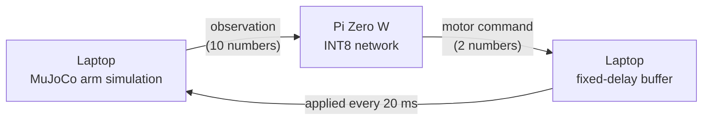

# Kote — quantized arm control on small chips

<p align="center"></p>

A simulated exoskeleton-style arm (MuJoCo, with gravity) controlled by a small neural network that is shrunk to 8-bit integers (INT8) and run on real low-power chips (Raspberry Pi Zero W, then ESP32-S3), with the simulator on a laptop in the loop. The goal is to measure where control quality breaks: lower precision, network delay, lost messages, and Linux board vs bare microcontroller.

> **Status: work in progress (2 Nov 2026).** The arm, the environment, the baselines, the teacher, the float student, INT8 quantization, the precision sweep, the delay-trained student and the simulated delay/loss sweep are done. The hardware loop (Pi Zero W) is next.

## How it works

1. **Arm:** 2-joint arm (shoulder + elbow) in the vertical plane, with human-sized masses and exoskeleton motors/struts that the arm has to carry.
2. **Teacher:** a classical controller (PD + gravity compensation) that reaches targets using the true simulator state.
3. **Student:** a small neural network that learns to copy the teacher from the 10 observation numbers only (behaviour cloning).
4. **Quantization:** the student is converted to INT8 (and lower bit-widths) with our own NumPy code.
5. **Hardware loop (planned):** the laptop runs the simulator, sends observations to the chip, and the chip sends back motor commands.



## Results so far (exo arm, same 100 seeded episodes)

Success = hand within 3 cm of the target after 1 second. This threshold is fixed and never changed.

| Controller | Success | Final distance | Reward |
|---|---|---|---|
| random | 0% | 54.58 ± 29.40 cm | −31.85 ± 12.94 |
| do-nothing | 0% | 65.76 ± 28.70 cm | −32.83 ± 14.35 |
| PD teacher | 100% | 0.03 ± 0.05 cm | −6.87 ± 4.08 |
| float student (10→64→64→2) | 100% | 0.11 ± 0.09 cm | −6.88 ± 4.08 |
| INT8 student (5.4 KB, integer maths) | 100% | 0.27 ± 0.16 cm | −6.94 ± 4.05 |

Reward is reported last on purpose: on the Reacher warm-up, doing nothing beat random on reward without ever reaching a target.

### Precision: safe down to 6 bits, breaks at 4

<picture>
  <source media="(prefers-color-scheme: dark)" srcset="media/precision_chart_dark.png">
  
</picture>

| Bits | everything | weights only | inputs only | hidden values only |
|---|---|---|---|---|
| 8 | 100% | 100% | 100% | 100% |
| 6 | 98% | 99% | 100% | 100% |
| 4 | 32% | 51% | 40% | 75% |
| 3 | 0% | 1% | 1% | 22% |
| 2 | 0% | 2% | 0% | 3% |

Rounding only the 10 inputs hurts about as much as rounding only the weights: with one shared scale, the input with the biggest range sets the step size for all of them.

### Delay: plain controllers break at 20–40 ms; a delay-trained student does not

<picture>
  <source media="(prefers-color-scheme: dark)" srcset="media/delay_chart_dark.png">
  
</picture>

<p align="center"></p>

| Delay | teacher | float student | INT8 student | delay-trained student |
|---|---|---|---|---|
| 0 ms | 100% | 100% | 100% | 100% |
| 20 ms | 75% | 79% | 78% | 100% |
| 40 ms | 9% | 29% | 22% | 100% |
| 60 ms | 4% | 11% | 5% | 100% |
| 80 ms | 2% | 2% | 0% | 100% |
| 100 ms | 1% | 2% | 3% | 100% |

Delay hurts far more than lost messages (30% loss with no delay: 99%). A plain controller reacts to where the arm *was*, so it overshoots. The delay-trained student also sees the commands it already sent that have not landed yet, and learns to look ahead, so it beats its own teacher. **Limitation:** it only works at the delay it was built for (e.g. the 20 ms student gets 12% at 0 ms), so the hardware loop will use a fixed-delay buffer to keep the delay constant. Details in [NOTES.md](NOTES.md).

## Run it

Windows, Python 3.12:

```bash
python -m venv .venv
.venv/Scripts/python.exe -m pip install -r requirements.txt
.venv/Scripts/python.exe sim/collect.py         # record the teacher (data/, ~10 s)
.venv/Scripts/python.exe sim/train_student.py   # train the student (~1 min)
.venv/Scripts/python.exe sim/quantize.py        # make the INT8 model
.venv/Scripts/python.exe sim/evaluate.py        # results table
.venv/Scripts/python.exe sim/precision_sweep.py # 8/6/4/3/2-bit sweep
.venv/Scripts/python.exe sim/delay_student.py   # train delay-trained students (~5 min)
.venv/Scripts/python.exe sim/delay_sweep.py     # delay / lost-message sweep
.venv/Scripts/python.exe sim/make_charts.py     # charts -> media/
.venv/Scripts/python.exe sim/make_gifs.py       # GIFs -> media/
.venv/Scripts/python.exe sim/watch.py teacher   # watch in the 3D viewer
```

## Files

| File | What it is |
|---|---|
| `sim/exo_arm.xml` | The arm, exoskeleton parts, seated wearer and scene (MuJoCo model) |
| `sim/exo_arm_env.py` | Gymnasium environment: start pose, targets, observations, reward |
| `sim/teacher.py` | Teacher controller: inverse kinematics + PD + gravity compensation |
| `sim/collect.py` | Records teacher (observation → action) pairs on practice seeds 1000..2999 |
| `sim/train_student.py` | Trains the student network to copy the teacher (PyTorch) |
| `sim/student.py` | Runs the student with plain NumPy (the code that gets quantized) |
| `models/student_float.npz` | Trained student weights |
| `sim/quantize.py` | Our own quantization: calibration, rounding to N bits, INT8 export |
| `sim/int8_net.py` | Integer-only INT8 runner, NumPy only (runs on the Pi) |
| `models/student_int8.npz` | INT8 student: int8 weights, int32 biases, scales |
| `sim/precision_sweep.py` | Rounds weights / inputs / hidden values at 8–2 bits → `results/precision_sweep.csv` |
| `sim/delay_student.py` | Delay-trained students (one per delay, 20–100 ms) → `models/student_delay*.npz` |
| `sim/delay_sweep.py` | Simulated delay, wrong-delay and lost-message tests → `results/delay_sweep.csv` |
| `sim/evaluate.py` | Scores any controller on seeds 0..99, optionally through a simulated delayed / lossy network |
| `sim/make_charts.py` | Draws the precision and delay charts (light + dark) from the CSV results |
| `sim/make_gifs.py` | Records the README GIFs from the side camera |
| `sim/watch.py` | Plays a controller in the live 3D window |
| `sim/random_reacher.py` | Reacher-v5 warm-up (random baseline) |
| `NOTES.md` | Design decisions, one paragraph each |

## Note

Code is written with AI assistance (Claude); every design decision is documented and explained in `NOTES.md`.
