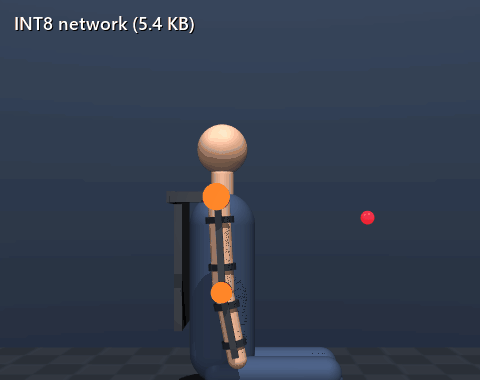
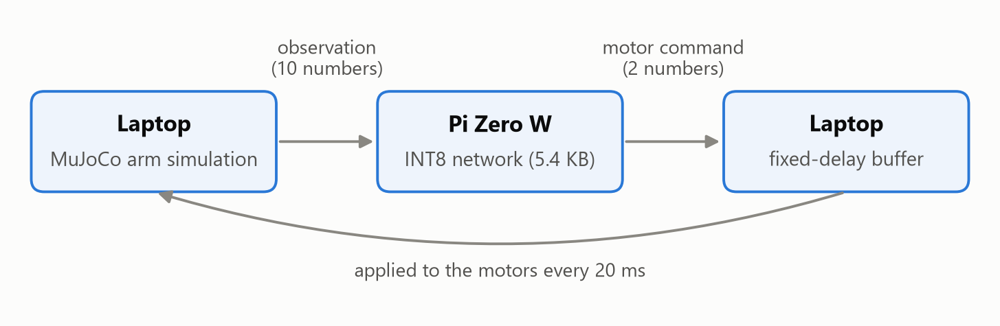
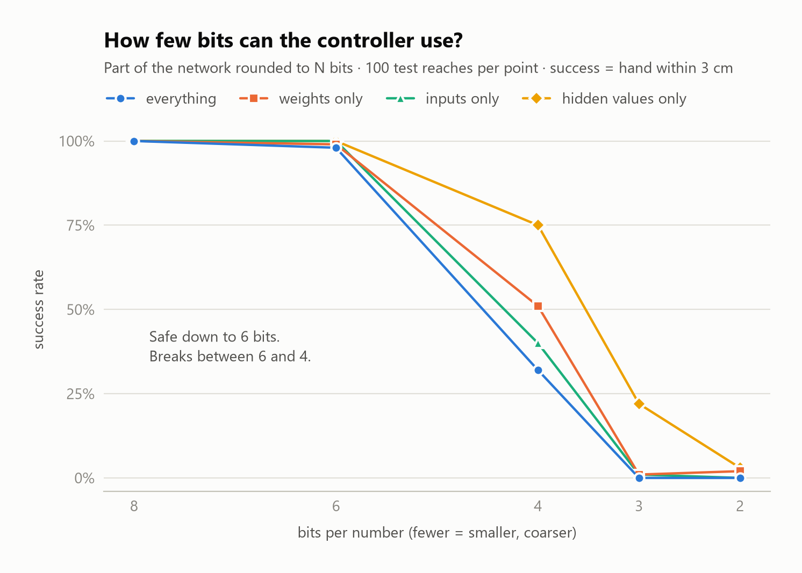
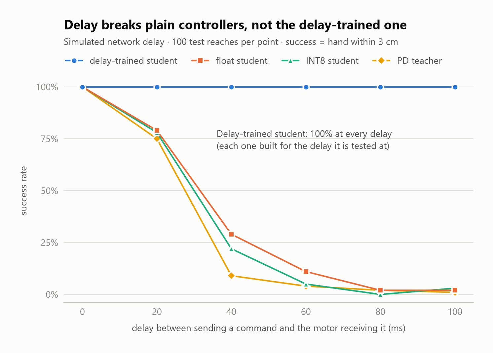
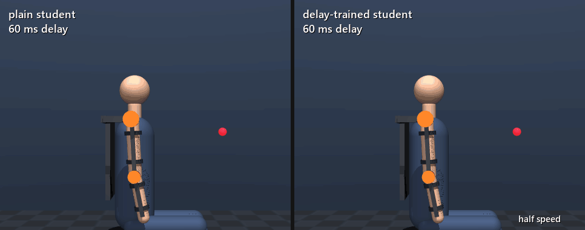

# Quantized arm control on small chips

<p align="center"></p>

A simulated exoskeleton-style arm (MuJoCo, with gravity) controlled by a small neural network that is shrunk to 8-bit integers (INT8) and built to run on low-power chips (Raspberry Pi Zero W, then ESP32-S3), with the simulator on a laptop in the loop. The goal is to measure where control quality breaks: lower precision, network delay, lost messages, and Linux board vs bare microcontroller.

> **Status (3 Nov 2026):** everything in simulation is done, and every controller runs in INT8. The hardware loop is built and tested against a stand-in "Pi" on the laptop, where it reproduces the simulation's predictions (same success rates, final distances within 0.01 cm). Runs on the real Pi Zero W are next (waiting for an SD card reader).

## How it works

1. **Arm:** 2-joint arm (shoulder + elbow) in the vertical plane, with human-sized masses and exoskeleton motors/struts that the arm has to carry.
2. **Teacher:** a classical controller (PD + gravity compensation) that reaches targets using the true simulator state.
3. **Student:** a small neural network that learns to copy the teacher from the 10 observation numbers only (behaviour cloning).
4. **Quantization:** the student is converted to INT8 (and lower bit-widths) with our own NumPy code.
5. **Hardware loop:** the laptop runs the simulator in real time, sends observations to the chip over UDP, and the chip sends back motor commands. Setup steps for the Pi: [pi/SETUP.md](pi/SETUP.md).

<picture>
  <source media="(prefers-color-scheme: dark)" srcset="media/loop_diagram_dark.png">
  
</picture>

## Results so far (exo arm, same 100 seeded episodes)

Success = hand within 3 cm of the target after 1 second. This threshold is fixed and never changed.

| Controller | Success | Final distance | Reward |
|---|---|---|---|
| random | 0% | 54.58 ± 29.40 cm | −31.85 ± 12.94 |
| do-nothing | 0% | 65.76 ± 28.70 cm | −32.83 ± 14.35 |
| PD teacher | 100% | 0.03 ± 0.05 cm | −6.87 ± 4.08 |
| float student (10→64→64→2) | 100% | 0.11 ± 0.09 cm | −6.88 ± 4.08 |
| INT8 student (5.4 KB, integer maths) | 100% | 0.27 ± 0.16 cm | −6.94 ± 4.05 |

Reward is reported last on purpose: on the Reacher warm-up, doing nothing beat random on reward without ever reaching a target.

### Precision: safe down to 6 bits, breaks at 4

<picture>
  <source media="(prefers-color-scheme: dark)" srcset="media/precision_chart_dark.png">
  
</picture>

| Bits | everything | weights only | inputs only | hidden values only |
|---|---|---|---|---|
| 8 | 100% | 100% | 100% | 100% |
| 6 | 98% | 99% | 100% | 100% |
| 4 | 32% | 51% | 40% | 75% |
| 3 | 0% | 1% | 1% | 22% |
| 2 | 0% | 2% | 0% | 3% |

Rounding only the 10 inputs hurts about as much as rounding only the weights: with one shared scale, the input with the biggest range sets the step size for all of them.

### Delay: plain controllers break at 20–40 ms; a delay-trained student does not

<picture>
  <source media="(prefers-color-scheme: dark)" srcset="media/delay_chart_dark.png">
  
</picture>

<p align="center"></p>

| Delay | teacher | float student | INT8 student | delay-trained student |
|---|---|---|---|---|
| 0 ms | 100% | 100% | 100% | 100% |
| 20 ms | 75% | 79% | 78% | 100% |
| 40 ms | 9% | 29% | 22% | 100% |
| 60 ms | 4% | 11% | 5% | 100% |
| 80 ms | 2% | 2% | 0% | 100% |
| 100 ms | 1% | 2% | 3% | 100% |

Delay hurts far more than lost messages (30% loss with no delay: 99%). A plain controller reacts to where the arm *was*, so it overshoots. The delay-trained student also sees the commands it already sent that have not landed yet, and learns to look ahead, so it beats its own teacher. **Limitation:** it only works at the delay it was built for (e.g. the 20 ms student gets 12% at 0 ms), so the hardware loop uses a fixed-delay buffer to keep the delay constant. Details in [NOTES.md](NOTES.md).

The delay-trained students also survive INT8: **100% at every delay from 20 to 100 ms**, with an average miss of 0.35–0.42 cm (float: 0.15–0.19 cm). These INT8 versions are what the chip runs.

### Hardware loop: tested with a stand-in Pi (real Pi Zero W next)

The chip program (`pi/pi_server.py`) is plain Python + NumPy, so it also runs on the laptop as a stand-in "Pi". The arm runs in real time: every 20 ms the laptop sends the observation over UDP and applies a command that has come back. Same 100 test episodes, every controller in INT8.

| Network | Controller | How answers are used | Success | Final distance | Round trip median / 99% | Simulation predicted |
|---|---|---|---|---|---|---|
| local (~1 ms) | INT8 student | lockstep (arm waits) | 100% | 0.27 ± 0.16 cm | 0.3 / 1.1 ms | 100%, 0.27 cm (no delay) |
| local (~1 ms) | INT8 student | as soon as it arrives | 78% | 1.74 ± 1.72 cm | 1.0 / 2.8 ms | 78%, 1.75 cm (20 ms delay) |
| local (~1 ms) | INT8 delay-trained | fixed 20 ms buffer | 100% | 0.35 ± 0.16 cm | 0.9 / 2.0 ms | 100%, 0.35 cm |
| pretend slow WiFi | INT8 student | as soon as it arrives | 6% | 10.69 ± 7.91 cm | 40.3 / 64.0 ms | |
| pretend slow WiFi | INT8 delay-trained | fixed 40 ms buffer | 74% | 2.88 ± 3.41 cm | 40.3 / 62.5 ms | |
| pretend slow WiFi | INT8 delay-trained | fixed 60 ms buffer | 100% | 0.57 ± 0.37 cm | 40.3 / 62.4 ms | |

The loop reproduces the simulation's predictions, so the simulated delay sweep is a fair forecast of the hardware. Even with every message answered, "as soon as it arrives" is never faster than one step (20 ms), which is why it scores 78%, not 100%. On the pretend slow network (the stand-in holds each answer 12–60 ms), the delay changes from message to message: the plain student collapses, a 40 ms buffer throws away 60% of answers and gets 74%, and a 60 ms buffer keeps 79% of them and gets 100%. Rule for the real Pi: measure the round trip, then pick the smallest buffer that almost every answer beats.

## Limitations

- **Simplified arm.** Two joints in one vertical plane, body parts as uniform capsules, no collisions, and no forces from the wearer: the exoskeleton moves a passive arm, it does not assist a person who is also pushing. Motors deliver the commanded torque instantly, up to a fixed cap (30 N·m shoulder, 15 N·m elbow): no motor dynamics, no heating, and no gearbox friction beyond simple joint damping.
- **The teacher is given a perfect model.** Its gravity compensation comes from the same physics model it controls. A real exoskeleton would have to measure or estimate masses and lengths, so the teacher (and the student copying it) would be less exact.
- **Simple task.** Still targets, reached from the arm hanging down, judged after 1 second. No moving targets, no pushes or disturbances during a reach.
- **100 test episodes.** One failure is one percentage point, so differences of a few points (e.g. 98% vs 100%) are within chance. Big gaps (100% vs 32%) are not.
- **Simplest quantization only.** One shared scale per tensor, set after training (post-training quantization). No per-input or per-channel scales and no quantization-aware training, which is how others reach 2–3 bits (see below). Here 4 bits fails.
- **The delay-trained student needs a known, fixed delay.** One model per delay, in steps of 20 ms. At the wrong delay it fails badly, so the loop forces the delay to be constant with a buffer, and throws away answers that arrive later than that.
- **Network effects are simulated or local so far.** The delay and loss sweeps are simulated; the stand-in Pi runs on the same laptop (round trip ~1 ms), and its "slow WiFi" is a made-up random delay. Real WiFi timing comes from the Pi runs.
- **Python on the chip.** The Pi does the integer maths through NumPy in Python, not in compiled C, so its timing includes Python's overhead. A bare-microcontroller (ESP32-S3) version in C is planned but not done.

## Related work

Running a quantized neural-network controller on a small chip is not new; this project does not claim it is.

- **QuaRL** (Krishnan et al., [arXiv 1910.01055](https://arxiv.org/abs/1910.01055); TMLR 2022): reinforcement-learning policies quantized to 6–8 bits without losing quality, comparing post-training quantization with quantization-aware training. The sweep here agrees: safe to 6 bits, breaks at 4.
- **Learning Quantized Continuous Controllers for Integer Hardware** (Kresse & Lampert, [arXiv 2511.07046](https://arxiv.org/abs/2511.07046); L4DC 2026): quantization-aware training reaches 2–3-bit MuJoCo control policies on small FPGAs, and finds that rounding the inputs matters on its own. The sweep here supports this: rounding only the inputs to 4 bits hurts about as much as rounding only the weights.
- **Quantization of DRL models for embedded microcontrollers** (Bohm et al., ICRA 2026): quantized deep-RL control policies on microcontrollers.
- **Quantized Deep Path-following Control on a Microcontroller** (Zometa & Faulwasser, [arXiv 2301.11909](https://arxiv.org/abs/2301.11909); ECC 2023): a network imitates a classical (predictive) controller and is quantized for a microcontroller, with an extra feedback law to correct quantization errors. The teacher–student setup here is similar in spirit.

**What this project adds:** an exoskeleton-style arm that has to carry its own motors against gravity; the same INT8 controller run in real time with the simulator in the loop over UDP (so far against a stand-in chip; Pi Zero W runs next); measured break points for precision, delay and lost messages on one fixed test set; and a delay-trained student that beats its own teacher under delay, with the catch that it only works at the delay it was trained for.

## Run it

Python 3.12. Commands below are for Windows; on **macOS / Linux** replace `.venv/Scripts/python.exe` with `.venv/bin/python` everywhere:

```bash
# macOS / Linux setup
python3 -m venv .venv
.venv/bin/python -m pip install -r requirements.txt
.venv/bin/python sim/collect.py   # ...and so on, same scripts as below
```

On macOS, change `torch==2.15.0+cpu` to `torch==2.15.0` in `requirements.txt` first (the `+cpu` builds exist for Windows and Linux only), and run the live viewer with `.venv/bin/mjpython sim/watch.py teacher` (MuJoCo's viewer needs `mjpython` on macOS).

```bash
# Windows
python -m venv .venv
.venv/Scripts/python.exe -m pip install -r requirements.txt
.venv/Scripts/python.exe sim/collect.py         # record the teacher (data/, ~10 s)
.venv/Scripts/python.exe sim/train_student.py   # train the student (~1 min)
.venv/Scripts/python.exe sim/quantize.py        # make the INT8 model
.venv/Scripts/python.exe sim/evaluate.py        # results table
.venv/Scripts/python.exe sim/precision_sweep.py # 8/6/4/3/2-bit sweep
.venv/Scripts/python.exe sim/delay_student.py   # train delay-trained students (~5 min)
.venv/Scripts/python.exe sim/quantize_delay.py  # INT8 delay-trained students (~1 min)
.venv/Scripts/python.exe sim/delay_sweep.py     # delay / lost-message sweep
.venv/Scripts/python.exe sim/make_charts.py     # charts -> media/
.venv/Scripts/python.exe sim/make_gifs.py       # GIFs -> media/
.venv/Scripts/python.exe sim/watch.py teacher   # watch in the 3D viewer
```

Hardware loop with a stand-in "Pi" on the same laptop (two terminals; on macOS / Linux use `.venv/bin/python`):

```bash
.venv/Scripts/python.exe pi/pi_server.py                                   # terminal 1: the "chip"
.venv/Scripts/python.exe sim/hw_loop.py --controller int8 --mode asap      # terminal 2: the arm
```

## Files

| File | What it is |
|---|---|
| `sim/exo_arm.xml` | The arm, exoskeleton parts, seated wearer and scene (MuJoCo model) |
| `sim/exo_arm_env.py` | Gymnasium environment: start pose, targets, observations, reward |
| `sim/teacher.py` | Teacher controller: inverse kinematics + PD + gravity compensation |
| `sim/collect.py` | Records teacher (observation → action) pairs on practice seeds 1000..2999 |
| `sim/train_student.py` | Trains the student network to copy the teacher (PyTorch) |
| `sim/student.py` | Runs the student with plain NumPy (the code that gets quantized) |
| `models/student_float.npz` | Trained student weights |
| `sim/quantize.py` | Our own quantization: calibration, rounding to N bits, INT8 export |
| `sim/int8_net.py` | Integer-only INT8 runner, NumPy only (runs on the Pi) |
| `models/student_int8.npz` | INT8 student: int8 weights, int32 biases, scales |
| `sim/precision_sweep.py` | Rounds weights / inputs / hidden values at 8–2 bits → `results/precision_sweep.csv` |
| `sim/delay_student.py` | Delay-trained students (one per delay, 20–100 ms) → `models/student_delay*.npz` |
| `sim/quantize_delay.py` | INT8 versions of the delay-trained students → `models/student_delay*_int8.npz` |
| `sim/delay_sweep.py` | Simulated delay, wrong-delay and lost-message tests → `results/delay_sweep.csv` |
| `sim/evaluate.py` | Scores any controller on seeds 0..99, optionally through a simulated delayed / lossy network |
| `pi/pi_server.py` | Runs on the chip: receives observations, runs the network, sends commands back (Python + NumPy only) |
| `pi/protocol.py` | Message formats shared by the laptop and the chip (UDP) |
| `pi/SETUP.md` | Step-by-step: flash the Pi, copy files, run the hardware tests |
| `sim/hw_loop.py` | Laptop side of the hardware loop: real-time simulation, lockstep / ASAP / fixed-delay buffer, timing log |
| `sim/hw_table.py` | Turns `results/hw/summary.csv` into README table rows |
| `sim/make_charts.py` | Draws the loop diagram, the precision and delay charts, and the round-trip timing chart once real-Pi results exist (light + dark) |
| `sim/make_gifs.py` | Records the README GIFs from the side camera |
| `sim/watch.py` | Plays a controller in the live 3D window |
| `sim/random_reacher.py` | Reacher-v5 warm-up (random baseline) |
| `results/` | Sweep results (`precision_sweep.csv`, `delay_sweep.csv`) and hardware-loop logs (`hw/`) |
| `NOTES.md` | Design decisions, one paragraph each |
